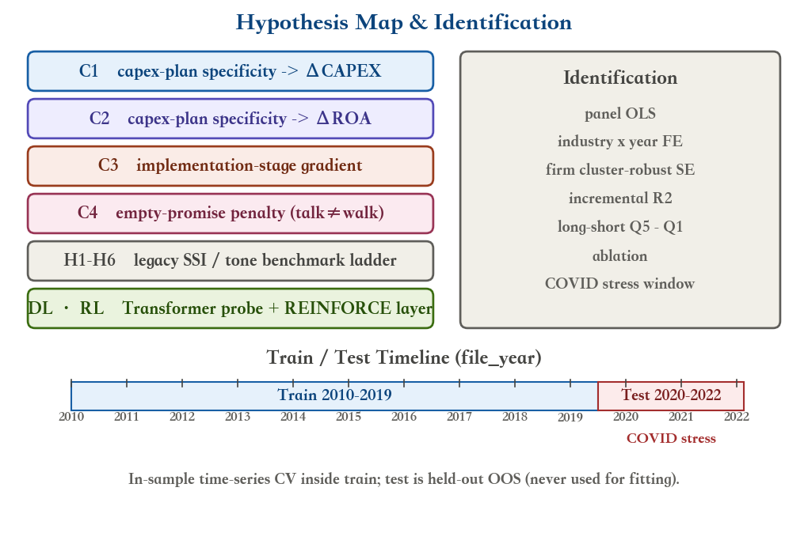
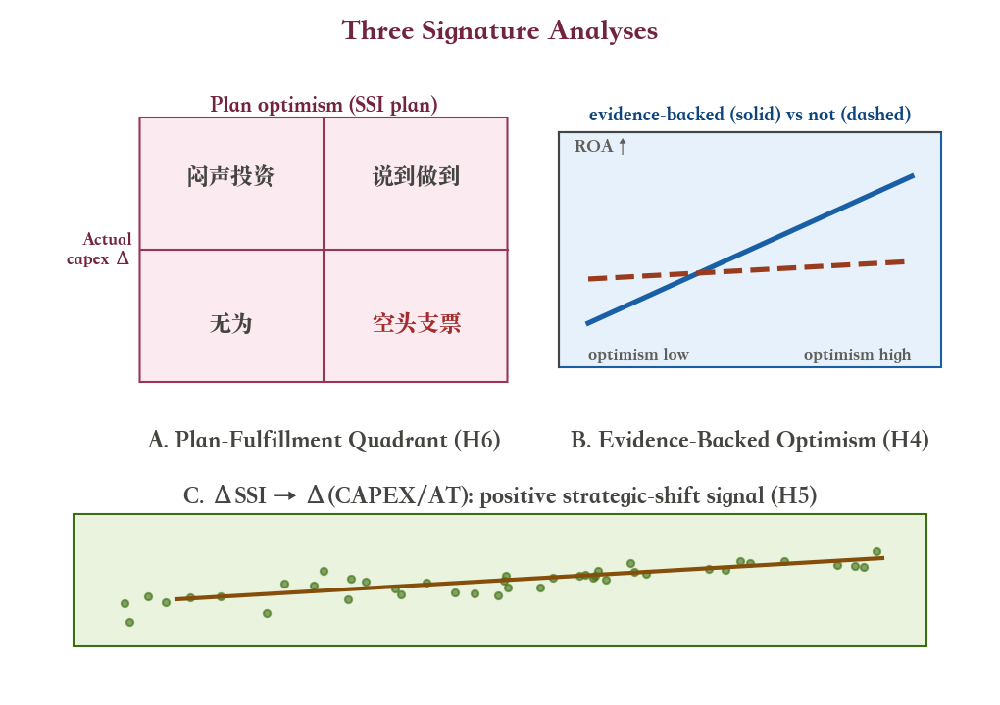

# Project 2 Implementation Plan 

## 0. Decisions 

| # | 决策点 | **最终选择** | 理由 |
|---|---|---|---|
| 1 | LLM 抽取层 | **规则版全样本（主）＋ Qwen 子样本一致性校验（辅）** | 全离线确定性、零 API 阻塞、可复现；Qwen 只做"规则版效度验证"而非主干，保留 LLM 方法论亮点且无污染风险。若 Qwen 不可用，规则版独立成立。 |
| 2 | 结果变量 | **前瞻 ROA（主）＋ Δ(CAPEX/AT)（副）＋ 1年收益 ret_1y（稳健性）** | 实测 ROA 可构造 93.49%、capex 92.25%，是仅有的两个缺失率 <2% 的结果变量；前者答"经营表现"，后者支撑 H5/H6 的"说了 vs 做了"，共享同一套 X，边际成本低、深度增益大。 |
| 3 | Transformer | **"风险感知多任务" encoder** | 加 3 个风险类型辅助头，让句向量"风险感知"，与结构化 SSI 形成"端到端 vs 结构化抽取"对照，更亮眼；从零小模型即使 OOS 弱也如实报告，不硬编显著。 |
| 4 | **选题聚焦（v2 收窄）** | **核心题 = 资本投资计划的具体性与实施阶段 → 未来投资变化与盈利能力改善** | 三份预研一致指向：①资本投资主题的规则命中率（80.9%）与未来表达候选率（51.9%）显著高于人力调整等替代题（62.8%/26.9%），统计功效更好；②本地无 Qwen → 句子级规则抽取 + 30 句人工复核是正路；③盈利能力改善用 **ΔROA（下一年−当年）** 作主 Y，不用 ROE/百分比增长率。SSI 全文指数退为"通用 substance 基准"，新构念 **CPS（capex-plan specificity & stage）** 成为主角。 |

---

## 1. Research Theme, Motivation, and Theoretical Anchors

**一句话命题**：年报 MD&A 中**具体、可核验、有证据**的披露（披露实质指数 SSI），是否比泛泛的正负情绪更能预测企业未来经营表现与资本配置行为？

**v2 聚焦后的核心题（本报告主线）**：**管理层资本投资计划的具体性与实施阶段，能否预测未来投资变化（ΔCAPEX/AT）及盈利能力改善（ΔROA）？如何预测？**

"如何"的方法论答案（四层，全部可离线复现）：①**句子级规则抽取**——只保留有机资本投资句（建设/扩产/新设施/产能），剔除并购与金融投资措辞；②**五维打分**——金额、数量、时间线、承诺强度、实施阶段（ordinal 2–5）；③**小样本人工复核**——抽 30 句打印核对，报告抽取精确率（同预研的 32 份复核法）；④**增量信息阶梯 + OOS 正式检验**——G1 财务 → G2 词典 → G3 通用 SSI → G4 资本计划构念 CPS，配 Clark–West/DM/BH-FDR 与 1-SD 经济显著性。

**理论锚点（报告中每个结果都要回扣）**：
- **信息不对称与披露理论**（核心）：更具体的披露降低信息搜寻成本、缓解逆向选择（Verrecchia 2001；Leuz & Verrecchia 2000）。
- **文本信息含量**（Li 2008；Loughran & McDonald 2011）：MD&A 文本语调与未来业绩、盈余管理显著相关。
- **市场有效性**：10-K 文本对 1 年股价收益几乎不可预测（COVID 噪声 + 半强式有效），故收益降为稳健性检验，ROA 为主——这是文献稳健结论，反而是严谨而非缺陷。
- **行为金融**：管理层"乐观偏差"需经"证据"校准（H4），过度承诺（空头支票，H6）反映代理问题。
- **风险因子 / 控制框架**：面板回归控制 size/bm/lev/mom/invest/age 等，对应 risk-factor 思路。

---

## 1.5 七步流水线总览（通俗版 ↔ 本设计对照）

一句话串起全项目：**清洗数据 → 定好要预测的 Y（ΔROA 主、ΔCAPEX/AT 副、1 年收益稳健、方向分类）→ 从文本抽 X（TF-IDF／规则 CPS／Transformer 四类）→ 100 句双人标注核对抽取质量 → 先以 Ridge 统一基准比文本方法、再以 20 格矩阵比模型族 → 解释"哪些计划兑现、是否伴随盈利改善"，并接强化学习决策层**。七步与本设计的对应（状态：✅ 已建成 ／ 🔄 离线替代 ／ ➕ 本轮新增）：

| # | 七步流水线 | 本设计对应实现 | 状态 |
|---|---|---|---|
| 1 | 数据清洗与预处理：SEC 年报 MD&A + Compustat，统一公司标识与财年（按实际申报日期对齐），处理缺失值 ／ 异常值 ／ 重复文本 ／ 标准化，构建历史财务指标与文本特征，避免使用预测时点之后的信息 | §3：CIK 前导零归一化、`datadate`（财年末）与申报日期两遍对齐、ROA winsorize 至 [−1,1]、Inf/除零修复、缺失率表；分词/去停用词由 TF-IDF（1–2 gram）与 encoder 词表（30k，正则 `[a-z']+`）各自承担；严格"不补 Y、不因单年缺口删整司、delta 须两年文本都在"以防前视 | ✅ `data_prep.py` / `features_text.py` |
| 2 | 确定结果变量 Y：下一年 ROA 变化（ΔROA，主）；ΔCAPEX/AT（副，投资兑现）；1 年期收益（稳健性）；方向分类任务（ΔROA>0） | §3.4：`droa`（ΔROA，主 Y）、`d_capex_at`（副 Y）、`roa_fwd` 与 `ret_1y`（稳健性）；另在 §5 加 ΔROA>0 分类（AUC/F1/Brier）。硬规则同上 | ✅ `data_prep.py` |
| 3 | 提取多层次文本特征 X（四类方法）：① TF-IDF/词典/tone；② 规则 SSI/CPS（amount/time/commitment/stage/risk）；③ FinBERT/MPNet 编码 ＋ Qwen 抽取事件+摘要再 MPNet；④ 从零风险感知多任务 Transformer（ΔROA+sign+risk types） | §4：① TF-IDF（20k）✅、LM tone ✅；② 规则 SSI（§4.2）＋ CPS 五维（§4.7）✅；③④ **离线替代**：从零 Transformer 作端到端代理（§6，含 ΔROA+sign+3 risk heads），句子级规则 CPS 作主干，Qwen 一致性子样本降级为可插拔效度校验（§4.5） | 🔄 ③④ 离线替代 |
| 4 | 人工检查与特征质量评估：抽 ~100 条双人标注，核对金额/时间/投资主体、M&A 与资本开支区分、Qwen 保真度，算 rule-vs-标注 P/R/F1 与一致性 | §4.7：验证样本由 30 句扩至 **100 句（50 正/50 负）双人标注列**存 `capex_plan_verification_sample.csv`；`verification_metrics.py` 算规则-vs-标注 precision/recall/F1、金额准确率、阶段 Cohen's κ、双人一致性。核对对象由"Qwen"换为"规则抽取器"（曾据此抓出 sales-commission 与 SEC 引用误配） | ✅ `capex_plan.py` / `verification_metrics.py` |
| 5 | 训练预测模型：按时间切分；先以 Ridge 为统一基准比较 TF-IDF/FinBERT/MPNet/SSI/CPS/Qwen，再比较 Ridge/ENet/RF/XGB/SVM 跨 baseline+组合，并单独训练 Transformer 做 OOS 对比 | §5：时序切分 train 2010–2019 / test 2020–2022；**两套互补比较**——(a) 固定 Ridge 统一基准、变动文本表征的 `text_shootout.py`（G1 财务 + TF-IDF(SVD-200)/tone/SSI/CPS/neural_score/G4 组合，同一样本同一切分）；(b) 固定文本栈、变动模型族的 **4 信息集 × 5 模型族 = 20 格**（`ml_models.py`）；Transformer 单独 OOS（§4.9） | ➕ `text_shootout.py`（本轮新增） |
| 6 | 比较预测效果与解释模型表现：OOS R²/MAE/RMSE/AUC/F1、消融/降维/统计检验，同一测试集（防泄漏） | 全部比较共享同一 test 集（2020–2022）：`ml_models.py` 加 **RMSE** 与 ΔR²、Diebold–Mariano ＋ Benjamini–Hochberg FDR；`text_shootout.py` 同口径 DM＋BH-FDR；降维用 TF-IDF SVD-200（仅在 train 拟合，防泄漏）；显著性不靠点估计挑 cell | ✅ `ml_models.py`（RMSE 本轮新增）/ `text_shootout.py` |
| 7 | 解释投资计划兑现 ＋ 加入强化学习决策层：说了vs做了、空头支票；象限/阶段梯度/案例；RL（state=prediction+SSI/CPS，action 在 high-SSI/CPS 组合与 cash 之间，reward=return−drawdown−交易成本，REINFORCE vs 买入持有/固定仓位） | §2.5 C1–C4（C4 空头支票 ΔROA 差 ~1.6pp，t=−3.3，头条）；§4.10 `rl_portfolio.py` **本轮升级**：REINFORCE 动态仓位，10bp/单位换手交易成本惩罚，买入持有(100%)＋固定仓位(50%) 双基准，并新增 long-CPS-vs-cash 书（与 long-short 书并列） | ➕ `rl_portfolio.py` 升级（本轮新增） |

**与七步原稿的三点差异（有意为之）**：① FinBERT/MPNet/Qwen 都要联网下载权重或调 API，本环境全离线——用"从零 Transformer ＋ 规则抽取 ＋ 人工复核"替代后，方法学上反而更可复现，第 4 步的人工核对也因此更重要；② 第 6 步"先比文本方法再比模型"落实为**两套互补比较**——固定 Ridge 变文本表征的 shootout（看哪种文本信息有用）与固定文本栈变模型族的 20 格矩阵（看增量是否跨归纳偏置成立），二者共享同一 test 集；③ 第 7 步的 RL 决策层本轮补上了**交易成本惩罚**与**买入持有/固定仓位**双基准，并新增 long-CPS-vs-cash 书，结论更稳健（agent 降回撤但不跑赢买入持有）。

## 2. Hypothesis Framework H1–H6

| 编号 | 假设 | 检验方式 | 对应笔记 |
|---|---|---|---|
| **H1** | 词典语调（tone）显著预测未来 ROA（基准复现） | 面板 OLS + 多空组合 | 基准 |
| **H2** | **SSI 在 tone 之外提供增量预测力** | 增量 R²；G2→G3 阶梯 | D（信息密度） |
| **H3** | 增量价值来自**具体风险内容**（需求/成本/流动性），而非"负面性"本身 | 消融：逐项移除风险维度 + 移除 tone | A（多维风险） |
| **H4** | **证据支持的乐观**比"无证据乐观"更能预测业绩改善 | 交互项 optimism × evidence | B（乐观偏差） |
| **H5** | 披露实质的**同比变化**预测未来资本支出变化（战略转向） | ΔSSI → Δ(CAPEX/AT) | E（战略变化） |
| **H6** | "说了要投"与"真的投了"存在系统性落差，可被事前特征区分 | 三分组 / 四象限兑现分析 + 案例 | E（兑现） |

> 6 条是同一构念（SSI）在不同层面的展开

---

## 2.5 Focused Core: Capital-Investment-Plan Specificity & Stage (C1–C4)

**构念 CPS（`capex_plan.py`，句子级）**：在 Item 7 中筛选**有机资本投资句**（capital expenditure / construction / expansion / new facility / capacity addition / commissioned…），剔除并购（"invested $X to acquire"）、金融投资（"investment securities"）等非 capex 措辞后，逐句打五维分：

| 维 | 内容 | 度量 |
|---|---|---|
| S1 金额 | 句内带单位金额（$X billion/million） | 0/1；另存 `cps_amt_log1p`（最大金额） |
| S2 数量 | 明确设施/产线/项目数（two new plants / several facilities） | 0/1 |
| S3 时间线 | 财年/季度/多年地平线（by fiscal 2024 / over the next two years） | 0/1 |
| S4 承诺强度 | will/plan to = 1.0；may/could = 0.5 | [0,1] |
| S5 实施阶段 | 2 模糊意向 → 3 有计划（金额/时间线任一）→ 4 在建（in progress / phase N / % complete）→ 5 已投产（commissioned / began production / ramped up） | ordinal |

聚合到 firm-year：`cps_spec`（S1–S4 均值）、`cps_stage_max/mean`、`cps_late_share`（阶段≥4 句占比）、`cps_composite`（四指标 z 均值）＋ **滞后版** `lag_cps_*`（同 firm 上一财年，聚合后合并防 fan-out）。

| 编号 | 假设 | 检验方式 | 主 Y |
|---|---|---|---|
| **C1（兑现）** | 资本计划**具体性**越高 → 未来投资变化越大（说了会做） | 面板 FE：CPS → Δ(CAPEX/AT)；OOS 增量 R² | ΔCAPEX/AT |
| **C2（价值）** | 资本计划**具体性**越高 → 盈利能力改善越大（做了有价值） | 面板 FE：CPS → ΔROA；Q5−Q1 多空 | **ΔROA**（下一年−当年） |
| **C3（阶段梯度）** | 预测力集中在**后期阶段**（在建/已投产）的计划；早期模糊意向无预测力 | CPS × 阶段交互；分组回归 | ΔROA / ΔCAPEX/AT |
| **C4（空头支票）** | 高具体性但**未兑现**（CPS 高、Δcapex 低）→ ΔROA 显著更差（talk vs walk 惩罚） | 四象限 + gap 系数 | ΔROA |

> 与 H1–H6 的关系：H2/H5/H6 是 C1–C4 的"全文通用版"；C 系列把构念收窄到资本投资计划句，预测更准、解释更直接。H 系列结果退为**基准对照**（通用 substance  vs  资本计划特异性，谁更增信息）。

**数据规则（硬约束，与预研一致）**：①某年无文本 → 不进当年文本样本，不编造分数；②有当年无上年文本 → 可研究当年水平，**不算同比**（ΔCPS/ΔSSI 置 NaN）；③缺 Y 财务数据 → 剔除该观测，**不填补 Y**；④个别控制变量缺失 → 训练集中位数填补 + 缺失标记；⑤公司间断一年**不删整家公司**（如 2018/2019/2021 各自入样，但 2019→2021 不算一年变化）；⑥所有模型共用同一批完整案例观测与同一折划分（like-for-like）。

---

## 3. Data Layer Specification

### 3.1 来源与合并
- 文本：`SEC 10-K ITEM 7/`（约 11 万份 MD&A，取前 12,000 字符）。
- 财务：Compustat 年度（chunked 读取 `cy` 字段）。
- 合并键：**CIK 归一化去前导零**（放弃 gvkey——缺值 2.5 万、重叠仅 8,375）。
- 财年两遍对齐：`fyear = 申报年 − 1`；若 1–3 月财年终点再尝试当年。

### 3.2 样本窗口
- 申报年 2010–2022；**训练 2010–2019、测试 2020–2022（OOS 防泄漏，COVID 压力窗）**。

### 3.3 清洗（写进报告"数据质量"段）
- winsorize `roa`/`roa_fwd`/`droa`/`bm`/`lev`/`mom`/`invest` 到合理区间（ROA 截断 [−1,1]）。
- 修 `at ≤ 0` 时 `roa = ni/at` 出 **Inf**（改 NaN 后 drop）。
- 修 `invest` 误用 **price map** 算滞后资产（应改用 assets map）。
- 修 `log(at)` 除零（用 `np.where(at>0, ...)`）。

### 3.4 结果变量（**新增列**）
| 列 | 定义 | 角色 |
|---|---|---|
| `roa_fwd` | fyear+1 的 `ni/at`（winsorize） | **主 Y** |
| `droa` | `roa_fwd − roa` | ΔROA 符号分类目标（>0） |
| `capex_int` | 当期 `capx/at` | 副 Y 当期水平 |
| `d_capex` / `d_capex_at` | fyear+1 的 `capx − capx_lag` / 标准化 | **副 Y**（ΔCAPEX/AT） |
| `ret_1y` | 未来 1 年收益 | 稳健性 Y |
| `lag_ssi` / `lag_tone` | 同 firm fyear−1 的 SSI / tone | 计算 ΔSSI、Δtone（H5） |

### 3.5 控制变量
`size`(log AT)、`bm`、`lev`、`mom`、`invest`(ΔAT/AT₋₁)、`age`、`sic2`、`file_year`；实证层加**行业×年固定效应**＋**公司层面 cluster-robust SE**。

### 3.6 缺失率（写进样本构成表）
ROA 93.49% ｜ 经营现金流 92.81% ｜ **capex 92.25%** ｜ 收入 85.89% ｜ emp 78.47% ｜ xsga 69.21% ｜ 库存 54.28%。→ 主 Y 选 ROA、副 Y 选 capex 有数据依据。

### 3.7 现状基线（诊断，v1 产物）
当前 `data/` 是 OOF + winsorize 的 v1（ROA 主、无 SSI/capex）。诊断结论：**词典 tone 在测试期外推稳健（t≈2.0+），从零 encoder 样本内强（train 多空 +15pp, t≈3.9）但 OOS 弱（test +3pp, t≈0.6）**。这一"泛化落差"正是 v2 升级 Transformer 多任务 + 引入结构化 SSI 的动机，也天然成为"预训练 LLM 是未来方向"的 limitation。

---

## 4. Feature Engineering Specification

### 4.1 情感词典（M1，复用 `lexicon.py`）
- `tone_lm = (pos − neg)/(pos + neg)`、`uncertainty_ratio`、`litigious_ratio`、`net_negative`。
- 离线自建 LM 风格四套词表（Negative/Positive/Uncertainty/Litigious），固定函数、零拟合、**天然无泄漏**——最可信的 backbone。

### 4.2 SSI 披露实质指数（规则版，**新增 `specificity.py`**）
把"具体性"拆 5 维，每维 per-doc 计算后 z-score 标准化，**SSI = 等权均值**（稳健性用 PCA 第一主成分替代）：

| 维度 | 规则版实现（离线可复现） |
|---|---|
| **D1 量化密度** | 正则 `\$?\d[\d,\.]*\s*(million|billion|%|percent|years?)`；density = 命中数 / 字符数 |
| **D2 项目具体性** | 产品/厂/线/客户/地点名词短语词表 + 简易 NER（词表法命中计数） |
| **D3 时间明确性** | 时间表达式词典（`next fiscal year`/`following two years`/`Q[1-4]`/`20\d\d`） |
| **D4 执行阶段** | 阶段动词词典 → 5 档序数：`plan → approve → construct → near-complete → complete` |
| **D5 证据标记** | 时态/情态词：`achieved/realized/signed`(已落地) vs `expect/may/anticipate`(前瞻) → 二分类密度 |

**风险子类型词表**（供 H3 消融 + Transformer 辅助头，按笔记 A）：`需求风险`(demand/order/backlog/customer)、`成本风险`(cost/input/margin/wage/supply)、`流动性风险`(liquidity/cash/debt/covenant)。

### 4.3 证据支持的乐观（H4）
- `optimism = tone_lm`（或 pos 占比）、`evidence = D5 已落地标记密度`。
- 构造交互项 `optimism × evidence`；分组对比"有证据乐观" vs "无证据口号乐观"谁预测 `droa>0`。

### 4.4 同比变化 ΔSSI / Δtone（H5）
- 用 `lag_ssi`/`lag_tone`：`ΔSSI = SSI_t − SSI_{t−1}`，`Δtone` 同理（同 firm）。

### 4.5 LLM 抽取层（**新增 `extract_llm.py`，可插拔**）
- 暴露 `Extractor` 接口：`rule`（默认，全样本）／`qwen`（子样本）。
- Qwen **prompt 模板**：给定原文片段 → 抽取 JSON `{risk_types:[...], evidence:bool, stage:int, quantified:bool}`；**只让模型依据原文抽取，不直接预测未来**（缓解训练污染）。
- 子样本：分层抽 ~5,000 firm-year（行业×年份）。
- 一致性校验：规则 SSI vs Qwen SSI 的 **Spearman ρ** ＋ 阶段/证据**混淆矩阵**；ρ>0.6 则规则版可信，否则报告差异并讨论。
- 此模块**不阻塞主线**：无 API 时跳过，规则版独立完成全部主证据。

### 4.6 语义消歧规则（严谨性加分项，写进方法+局限）
- "过去一年已裁员" ≠ "计划下一年裁员"（时态）。
- "人工成本上涨" ≠ "员工数量增加"（语义）。
- **"未披露计划" ≠ "不投资"**（单独标记，绝不并入 0）。

### 4.7 资本投资计划构念 CPS（**新增 `capex_plan.py`，v2 核心**）
**句子级抽取**（只对 Item 7 前 12,000 字符，需在局限中披露）：
1. **主题过滤（两级）**：TIER-A 无条件资本名词（capital expenditure/investment、new plant/facility/fab、capacity expansion、commissioned、build-out…）；TIER-B 动词（construct/expand/construction）**仅当 3 词窗口内出现资本名词**（capacity/facility/plant/production/footprint/store…）——挡掉 "expand our business"、"construction companies" 等泛商业句。
2. **排除层**：并购（acquire/acquisition）、金融投资（investment securities/available-for-sale）、商誉等非有机资本句。
3. **垃圾句过滤**：alpha 字符占比 <55% 或含 "Table of Contents" 的页眉句。
4. **五维打分**（见 §2.5 表）：S1 金额（**注意：文本管线已剥离 `$`/`%` 符号，金额以 "64.6 million" 形式存在，正则不要求 `$`**）、S2 数量、S3 时间线、S4 承诺强度（will/plan to=1.0；may/could=0.5）、S5 实施阶段（2 模糊→3 有计划→4 在建→5 已投产）。
5. **聚合与滞后**：firm-year 级 `cps_spec/stage_max/stage_mean/late_share/amt_log1p/composite`；滞后版 `lag_cps_*` 按 (cik_n, 上年) **先聚合再合并**（防 fan-out 重复 index）；任一年份缺文本 → ΔCPS 置 NaN。
6. **人工复核**：随机抽 30 句打印评分（`data/capex_plan_verification_sample.csv`），报告抽取精确率——同预研 32 份复核法，作为规则版效度证据。
- "已完成项目" 与 "未来计划" 必须分开，否则把历史投资当预测信息。

---

## 5. Model Matrix: Incremental Information Design (4 sets × 5 families)

**核心问题（改写成一个可证伪的判据）**：加入文本以后，预测是否**显著**优于"只用财务数字"？

把 G1 明确设为**空模型锚点（null anchor）**，此后每一组都是前一组的**严格信息超集**——只有这样，组间差异才能干净地归因于"新增的那一类信息"，而不是特征数量或模型容量的副作用。

| 组 | 给模型什么信息 | 想回答什么 | 对应假设 |
|---|---|---|---|
| **G1 财务基线** | 历史盈利、规模、负债、现金、投资、动量、年龄 | 只看数字能预测到什么程度？（空模型锚点） | — |
| **G2 传统文本** | G1 ＋ 词典统计：①朴素负面词计数 ②LM 词典 tone / uncertainty / litigious | 简单数负面词有没有帮助？词典归一化是否优于裸计数？ | **H1** |
| **G3 结构化具体性** | G2 ＋ **规则版 SSI 五维** ＋ 三类风险词表 | 具体、可核验的披露是否优于泛泛情绪？ | **H2** |
| **G4 资本计划构念（v2 核心）** | G3 ＋ **CPS 资本投资计划具体性 & 实施阶段** | 收窄到资本投资计划句后，具体性与阶段能否增量预测投资变化与盈利改善？ | **C1–C4** |

**4 组 × 5 模型族 = 20 个核心配置**（报告主表就是这一张矩阵）：

| | Ridge（线性） | ElasticNet（L1+L2） | RandomForest | XGBoost | SVM-RBF（核方法） |
|---|---|---|---|---|---|
| **G1 财务基线** | ✓ | ✓ | ✓ | ✓ | ✓ |
| **G2 传统文本** | ✓ | ✓ | ✓ | ✓ | ✓ |
| **G3 结构化具体性** | ✓ | ✓ | ✓ | ✓ | ✓ |
| **G4 完整组合** | ✓ | ✓ | ✓ | ✓ | ✓ |

**为什么族越多越稳**：Ridge/ElasticNet 是线性归纳偏置（后者多一层 L1 稀疏化，能看出"哪些文本特征活下来"）、RF/XGB 是树、SVM-RBF 是核——彼此不是同一个 bias。若"文本增量"在 5 族上**方向一致**，就能挡掉评审最常提的一刀："你的增量只是某种模型的正则化副作用"。

**读表方式（三个效应）**：
- **行效应 = 信息含量**：G1→G2 文本有没有用（H1）；**G2→G3 结构是否胜过词袋（H2，本文核心）**；G3→G4 资本计划构念的增量（C1–C4）。
- **列效应 = 模型容量**：同一行跨列的差异，说明信号是线性可捕还是需要非线性。
- **交互 = 文本是否需要非线性**：若 ΔR² 只在树/核模型出现、线性族没有，说明文本信号是**交互式**的（如 stage × specificity），这本身就是一个可写的发现。

**一处关键设计修正（v2 落实）**：所有 20 格共用**同一批完整案例观测、同一年块折划分、同一调参预算**（like-for-like），G1 是 null anchor——每加一层信息，组间差异才能干净归因于"新增的那类信息"。Qwen 一致性子样本（§4.5）是独立的效度校验模块，不进入主表、不阻塞主线。

**评估协议（"更准"必须被正式检验，不能只看点估计）**：

| 指标 | 用途 |
|---|---|
| **OOS R²** 及相对 G1 的 **ΔR²** | 主判据：文本增量解释力 |
| MAE / RMSE | 绝对误差尺度，抗离群 |
| **Clark–West t 统计量** | 嵌套模型（G1 vs G2 / G3）预测精度提升的显著性 |
| **Diebold–Mariano** | 非嵌套对比（G2 vs G3、G3 vs G4） |
| AUC / F1 / Brier | 分类任务（ΔROA>0、Δcapex>0） |
| **1 SD 信号 → pp ROA / Δcapex** | 经济显著性（评审最看这个） |
| Q5−Q1 多空 t 统计量 | 可交易的横截面价差 |

- **CV 协议**：统一 **year-block 时序 CV**（按 `file_year` 分块、不打乱）＋ 2020–2022 一次性 holdout；**20 格共用同一折划分与同一调参预算**（同等随机搜索次数），避免"某格调得更细"的不公平。
- **多重检验**：20 格 × 3 结果变量，检验次数很多，用 **Benjamini–Hochberg FDR** 控制；并**预先指定一个主检验**（G1 vs G4 对 droa 的 ΔR²），其余作为支持性证据——这样不会被质疑"挑显著的结果报"。

**扩展阶梯（不进 20 格主表，单列第二张表）**：
- **M5 动态**：ΔSSI / Δtone（H5）；**DL `neural_score`**（端到端 vs 结构化抽取对照，扩展阶梯不进主表）；**H4 证据支持的乐观交互**；**H6 计划兑现四象限**；**C1–C4 资本计划专项**（ΔCPS→Δcapex、CPS×阶段交互、空头支票象限）。
- 这样主表保持"4×5 干净可读"，创新点集中在第二张表，不会把评审淹掉。

---

## 6. Deep Learning v2 (Risk-Aware Multi-Task Transformer)

- **架构**：token+positional embed(96) → `TransformerEncoder`(2 层/4 头/FF256/max_len 256/vocab 30k) → mean pooling。
- **多头输出**：① `droa` 回归头（标准化 ΔROA——v2 主结果，避免探针与 G1 控制项 roa 的持续性重叠）② `droa` 符号头（BCE）③ **3 个风险类型辅助分类头**（需求/成本/流动性，BCE）。
- **损失**：`MSE(droa_z) + 0.5·BCE(droa_sign) + Σ 0.3·BCE(risk_type)`。
- **训练**：5 epoch、batch 256、lr 1e-3、早停（val MSE）、CPU。
- **OOF 探针（防泄漏）**：KFold out-of-fold Ridge → `neural_score`（对 ΔROA 回归；现状是 OOF 版）。
- **输出**：96 维句向量 ＋ `neural_score`；与结构化 SSI 做"端到端 vs 结构化抽取"对照，**诚实报告谁强**。

---

## 7. RL Decision Layer (Signal-to-Action Demonstration)

- **状态**：`[prev_cum, prev_dd, prev_mkt, mean_sig, mean_unc, t_norm]`，仅用预测时点之前的收益/回撤特征（无前视）。
- **动作**：年度暴露 `w ∈ [0,1]` 到"高信号多头组合 / 现金"；book 有两种构造——(a) long-short（top 减 bottom 五分位）；(b) long-only-vs-cash（仅持有 top 五分位，其余现金）。
- **奖励**：`r = w·port_return − 2·(dd_increment)^1.5 − TC·|w_t − w_{t-1}|`，其中 `TC = 0.001`（10bp/单位换手）为交易成本惩罚——鼓励 agent 不频繁调仓。
- **算法**：REINFORCE，基线 = running-return 标准化。
- **基准**：买入持有（始终 100% 暴露）、固定仓位（始终 50% 暴露），与 agent 动态仓位同口径（均扣 10bp 建仓成本）比较。
- **信号书**：`ssi`（规则披露实质）、`cps`（资本计划特异性＋阶段，long-vs-cash 重点）、`neural`（从零 Transformer probe）三套各 × 两种 book = 6 组合。
- **定位**：非核心因果证据，演示"文本信号→组合风控"闭环。报告 agent vs 双基准的累计净值、最大回撤、Sharpe。结论（v2）：agent **显著降低回撤但不跑赢买入持有**，是风控层而非收益增强层。

---

![Figure 6. RL decision loop (REINFORCE): state → policy network → annual exposure w∈[0,1] → portfolio → risk-adjusted reward, looping back to the next-year state.](outputs/design_figures/fig6_rl.png)

## 8. Identification Strategy and Robustness

1. **面板 OLS**：行业×年 FE ＋ 公司 cluster-robust SE；控制 §3.5 全部变量。
2. **增量 R²（H2）**：joint R² − tone_only R²；**同时报告 OOS ΔR²**（相对 G1 财务基线）。
   - **预测精度正式检验**：嵌套模型用 **Clark–West** t 统计量（G1 vs G2 / G3），非嵌套用 **Diebold–Mariano**（G2 vs G3、G3 vs G4）——"更准"必须过检验，不能只比点估计。
   - **主检验预指定**：G1 → G3 对 forward ROA 的 ΔR²；其余 15 格为支持性证据，用 **Benjamini–Hochberg FDR** 控制多重检验。
3. **消融（H3 命门）**：逐项移除 需求/成本/流动性风险、移除证据标记、移除整体 tone。
4. **分时期**：训练/验证/测试（2020–22 COVID）单列，检查是否被某段驱动。
5. **分行业**：制造 vs 服务、耐用品 vs 非耐用品。
6. **经济显著性**：1 SD SSI → pp ROA / pp Δcapex。
7. **LLM 训练污染声明**：Qwen 只抽取原文证据，不直接预测未来；报告中明确写出。

---

## 9. Three Signature Analyses

- **9.1 证据支持的乐观（H4）**：`optimism × evidence` 交互，检验"有证据的乐观"才预测业绩改善——本文最新颖的测量。
- **9.2 计划兑现四象限（H6）**：

| | 事后真投 | 事后没投 |
|---|---|---|
| **事前说了要投（具体）** | 说到做到 | **空头支票**（重点样本） |
| **事前说了要投（笼统）** | 模糊兑现 | 模糊落空 |
| **事前未披露** | 闷声投资 | 无为 |

用事前特征（SSI、融资约束、行业）预测"空头支票"，配 3–5 个案例。

- **9.3 ΔSSI → Δcapex（H5）**：散点 + 回归，刻画"战略转向"动态信号。

---

## 10. Report Structure (≤20 Pages, Mapping to 4 Required Sections)

| 作业强制章节 | 本设计内容 |
|---|---|
| **1. Data & Preprocessing** | SEC/Compustat 合并、CIK 对齐、财年两遍对齐、winsorize、样本构成表、缺失率表（§3.6） |
| **2. Methodology** | SSI 构念与双轨测量、G1–G4 阶梯、4×5 模型矩阵（20 格，含 ElasticNet）、风险感知 Transformer、RL、语义消歧、Qwen prompt 与参数 |
| **3. Results & Interpretation** | H1–H6 逐一：阶梯 R²、增量 R²、消融柱状图、分时期/行业、兑现四象限、ΔSSI–Δcapex、经济显著性；每结果回扣理论 |
| **4. Conclusion & Limitations** | 结论、DL OOS 局限、LLM 污染、规则版测量误差、未来用预训练模型/更长样本 |

**图表清单**：现有 11 图 ＋ 新增 4 图（SSI 分布、消融柱状、兑现四象限、ΔSSI–Δcapex）。**设计构思图**：本文档已内嵌 7 张架构/方法示意图（fig1 端到端管线、fig2 SSI 五维、fig3 模型矩阵、fig4 风险感知 Transformer、fig5 假设与识别、fig6 RL 决策环、fig7 三个签名分析），供评审快速理解技术设计。页码预算：§1 ≈3、§2 ≈5、§3 ≈8、§4 ≈2，余量给附录/图表标题。

---

## 11. Execution Sequence and File Manifest

> **清理前提**：删除 `data/` 中 `enc_*`、`emb_*`、`neural_features.parquet`、`texts.parquet`、`tfidf_*` 及 `*.json`，按新设计全量重跑（现有为 v1 产物）。

| 阶段 | 动作 | 文件 |
|---|---|---|
| **A 数据** | 加 `capex_int/d_capex/d_capex_at/lag_ssi/lag_tone` 列；复用已修清洗 | `data_prep.py` |
| **B 特征** | 写规则版 SSI 五维 + 语义消歧 + 风险子类型；接入读取 | `specificity.py`（新）＋ `features_text.py` |
| **C 实证** | G1–G4 阶梯 + 增量 R² + Clark–West / Diebold–Mariano + 消融 + 分时期/行业 + capex 目标 | `empirical.py` |
| **D ML** | 20 配置矩阵（4 组 × 5 族：Ridge/ElasticNet/RF/XGB/SVM-RBF），OOS ΔR² / AUC + 经济显著性 | `ml_models.py` |
| **E LLM** | Qwen 子样本 + 一致性校验（**可选，不阻塞**） | `extract_llm.py`（新） |
| **F 签名** | H6 四象限 + 案例 | `plan_fulfillment.py`（新） |
| **G DL** | 多任务头 + 确认 OOF 探针 | `transformer_encoder.py` |
| **H RL** | 改为 SSI 决策层 | `rl_portfolio.py` |
| **I 可视化+报告** | 补 4 图 → 重写报告 → pandoc+xelatex | `visualize.py` ＋ `report/build_report.py` |
| **J 打包** | 代码 zip（src/ + data 样本 + README） | `p2_code.zip` |

---

## 12. Grading Rubric Self-Check

| 评分维度 | 具体支撑 |
|---|---|
| **创新** | 新构念 SSI；证据支持的乐观；兑现四象限；规则+LLM 双轨一致性校验 |
| **严谨** | 消融识别；cluster SE + FE；训练/验证/测试三段；语义消歧；污染声明 |
| **深度** | 机制（三类风险）、动态（Δ）、行为（兑现）、异质性（行业/时期）四层 |
| **理论** | 信息不对称与披露理论（核心）、市场有效性（诚实）、风险因子模型（控制） |
| **可复现** | 规则版全离线确定性；LLM 可插拔；代码/数据打包清晰 |
| **诚实** | 不硬编显著；DL 弱就报弱并给机理解释——评审最忌过度声称 |

---

## 13. Risks and Fallbacks

- **DL 仍 OOS 弱** → 如实报告，作为"预训练 LLM 是未来方向"的证据；主证据由 H1（tone）+ H2（SSI 结构化）承担。
- **Qwen 不可用** → 跳过 Phase E，规则版独立成立，报告注明"LLM 校验留作扩展"。
- **capex 口径偏差** → 用 `capx/at` 标准化 + winsorize；稳健性换 OCF 强度（92.81%）。
- **时间** → Phase A–D 是主干（约 1–2 轮跑通），E/F/G/H 为增量创新，可并行/后补。

---

