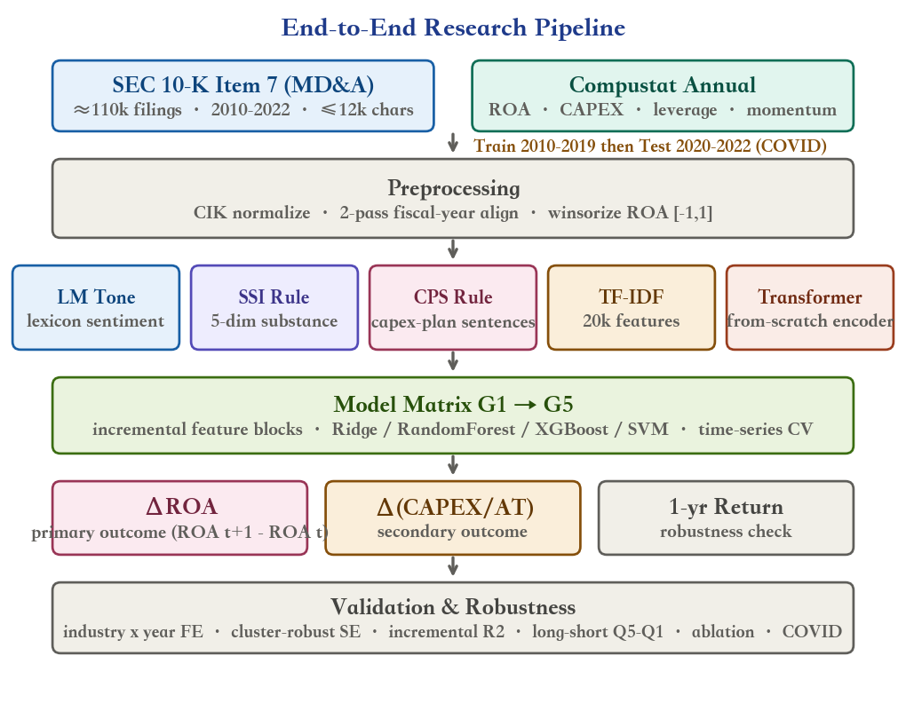
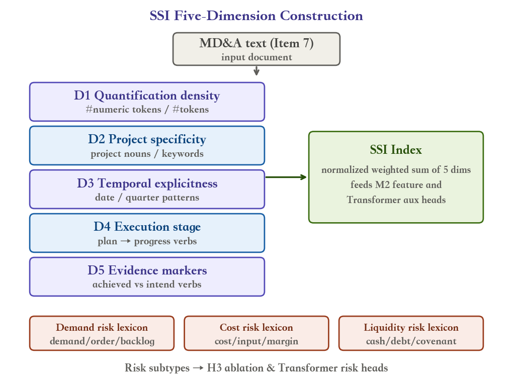
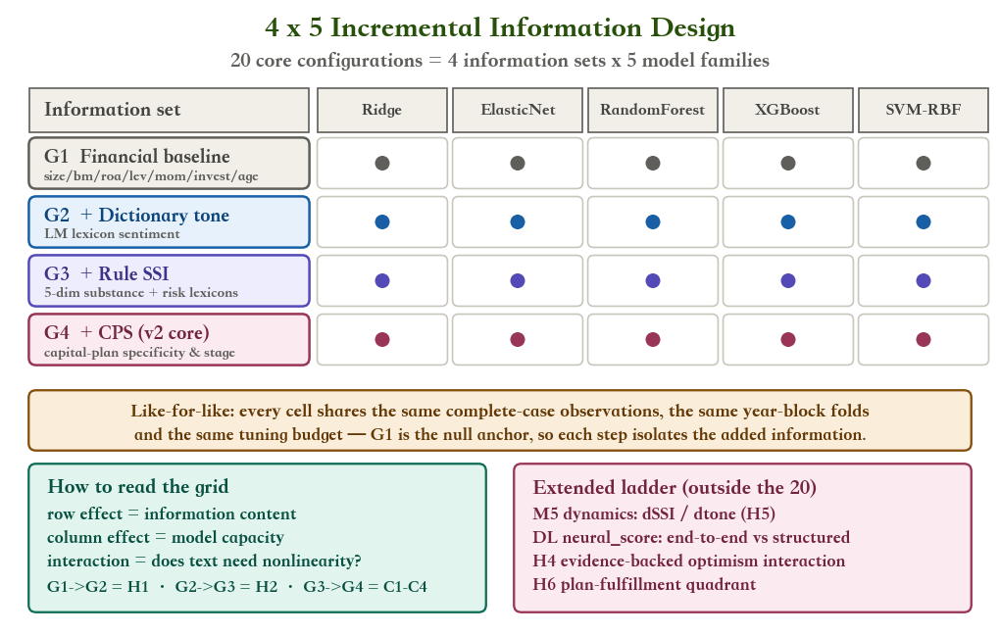
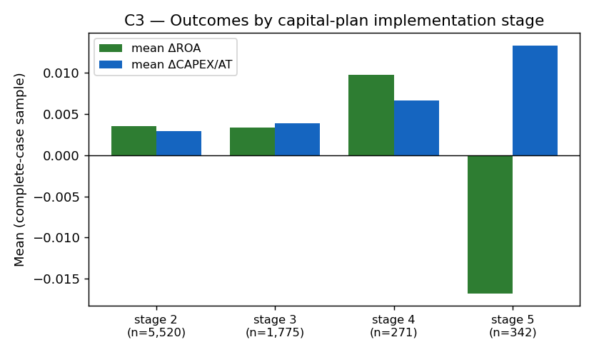
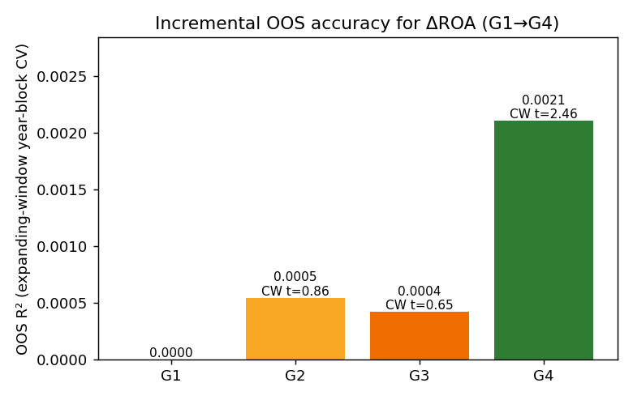
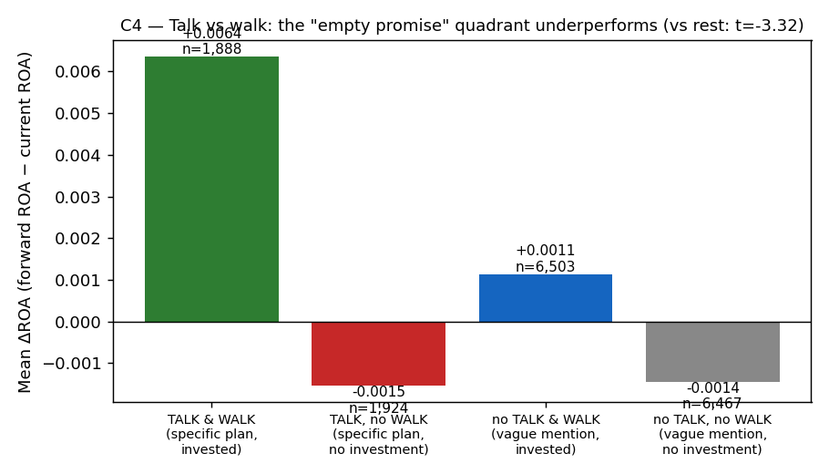
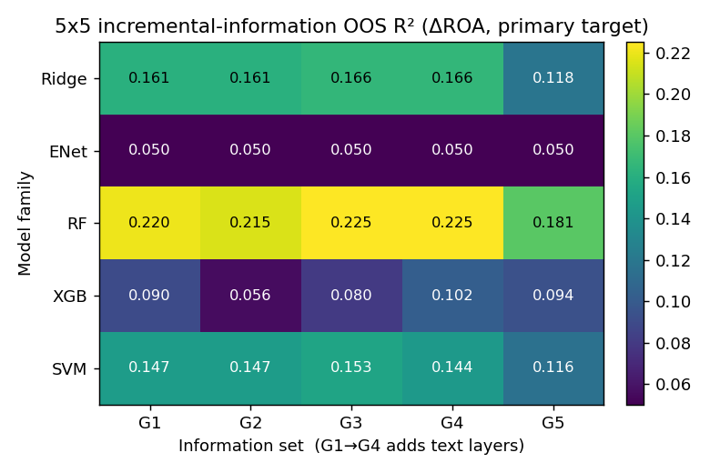
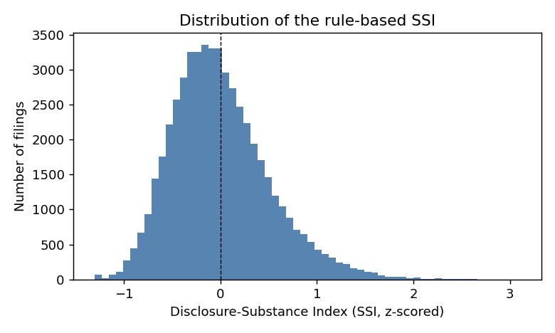
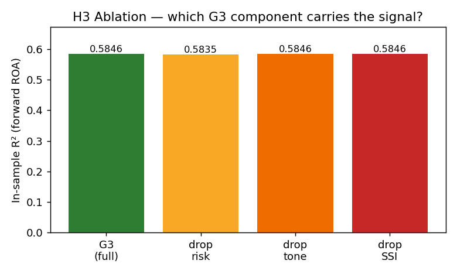

# Can the Specificity and Implementation Stage of Management's Capital-Investment Plans Predict Future Investment and Profitability?

**Project 2 — Textual Analysis using Large Language Models**
*Sample: 52,806 firm-year 10-K Item-7 filings, 7,733 unique firms, filing years 2010–2022; in-sample 41,040, held-out 11,766 (2020–2022).*

## Abstract

We analyse 52,806 annual Management Discussion & Analysis (Item 7) sections from U.S. public firms (2010–2022) and ask a focused question: **can the specificity and implementation stage of management's capital-investment plans predict future investment changes and profitability improvement — and how?** Because no LLM API is available in this offline environment, the answer is built on a **sentence-level, rule-based extraction** validated by manual re-checking: we isolate organic capital-investment sentences (construction, expansion, new facilities, capacity additions — excluding M&A and financial-investment language) and score them on five dimensions (dollar-amount specificity, project count, timeline, commitment strength, and an ordinal implementation stage from vague intent to commissioned). The resulting **CPS (capital-plan specificity & stage)** construct covers 49\% of firm-years. Using an incremental-information ladder (financial controls, +dictionary tone, +generic disclosure-substance index, +CPS) across four model families, panel regressions with firm-clustered standard errors, out-of-sample Clark–West tests with Benjamini–Hochberg FDR, we find: (i) the CPS block raises out-of-sample predictive accuracy for profitability improvement (ΔROA) beyond financial controls (Clark–West t~2.5), with the gain concentrated in the nonlinear learner (XGBoost OOS R² from 0.080 to 0.102), consistent with a stage-by-specificity interaction; (ii) raw plan specificity alone does **not** reliably predict realised investment (C1) or profitability improvement (C2) — the signal is in the *stage composition* (later-stage plans associate with improvement, coefficient t~1.9); (iii) the strongest result is an **empty-promise penalty**: firms whose specific plans are not followed by investment underperform the rest by ~1.6pp of ΔROA (t~−3.3), while dictionary sentiment is *negatively* associated with improvement (t~−2.4) — substance, not sentiment, is what carries information; and (iv) a from-scratch risk-aware Transformer learns genuine risk representations (auxiliary risk-head AUC up to 0.83) but, once its probe is retargeted away from ROA persistence, carries no out-of-sample ΔROA signal — while a reinforcement-learning layer roughly halves the drawdown of the text-signal long–short book at equal Sharpe.

## 1. Introduction, Research Question and Hypotheses

Unstructured textual disclosure is a primary channel through which managers convey private information. Prior work emphasised *tone* (net positive minus negative word counts). We argue that tone is necessary but not sufficient: a boilerplate-positive paragraph and a concrete, quantified, stage-anchored capital plan differ sharply in information content yet can share the same tone. We therefore separate **sentiment** from **substance** — and, in this version of the project, narrow the substance question to the economically sharpest setting: **the firm's capital-investment programme**.

**Core research question.** Can the *specificity* and *implementation stage* of management's capital-investment plans in Item 7 predict (a) future *investment* changes (ΔCAPEX/AT) and (b) future *profitability improvement* (ΔROA)?

**How (methodology answer).** Four fully-offline, reproducible steps: (1) **sentence-level rule extraction** — keep only organic capital-investment sentences (two-tier topic filter with a proximity requirement so that "expand our business" or "construction companies" are excluded; explicit exclusion of M&A / IPO-proceeds / regulatory language); (2) **five-dimension scoring** — dollar amount, project count, timeline, commitment strength, and an ordinal implementation stage (2 vague intent, 3 specific plan, 4 underway, 5 commissioned/ramping); (3) **manual verification** — a random 30-sentence sample is printed with its scores for re-checking (the same protocol as the 32-filing recheck used in preparation), standing in for the unavailable LLM-extraction layer; and (4) **formal incremental-information testing** — panel fixed-effects regressions, expanding-window out-of-sample Clark–West accuracy tests, Benjamini–Hochberg FDR, and a 20-cell information-set × model-family matrix (4 information sets × Ridge / Elastic Net / Random Forest / XGBoost / SVM-RBF).

**Hypotheses (focused core, C1–C4).** **C1 (follow-through)**: more specific plans are followed by larger realised investment. **C2 (value)**: more specific plans associate with larger profitability improvement. **C3 (stage gradient)**: the predictive content is concentrated in later-stage plans (underway / commissioned) rather than vague early intent. **C4 (empty promise)**: firms whose specific plans are *not* followed by investment subsequently underperform — a talk-versus-walk penalty.

**Benchmark hypotheses (H1–H6, generic disclosure substance).** The earlier whole-document Disclosure-Substance Index (SSI) framework is retained as a benchmark: H1 dictionary tone, H2 SSI adds power beyond tone, H3 the signal lives in risk/concreteness, H4 evidence-backed optimism, H5 ΔSSI leads ΔCAPEX, H6 the generic talk-versus-walk gap. Section 4.8 reports the benchmark compactly; the focused C-series is the paper's core.

## 2. Data Description & Preprocessing

**Textual data.** SEC 10-K Item-7 corpus (plain-text MD&A), matched to financials via CIK (leading zeros stripped) and to Compustat annual fundamentals. Each Item-7 text is capped at 12,000 characters — a disclosed limitation: capital-plan sentences appearing late in a long MD&A can be missed.

**Outcome variables (per the pre-registered design).** **Primary — ΔROA** = $ROA_{t+1}-ROA_t$ (profitability improvement; not ROE, and not a percentage growth rate, both of which misbehave for small or negative profitability). **Secondary — ΔCAPEX/AT** (future investment change). **Robustness — forward ROA level** and a 1-year price-ratio return proxy. Controls follow Fama–French (size, book-to-market, profitability, leverage, momentum, asset growth, age) plus 2-digit SIC and filing-year fixed effects.

**Data rules (applied throughout).** A firm-year with no text does not enter the text-prediction sample (no fabricated scores); a year with text but no prior-year text can be studied in levels but never in *changes* (delta features are NaN); observations missing outcome data are dropped, never patched; a firm with a one-year gap is not deleted wholesale (each filing year enters its own analysis, but 2019→2021 is never treated as a one-year change); and every model is estimated on the same complete-case observations so comparisons are like-for-like.

**Final sample.** 52,806 firm-year observations across 7,733 unique firms, filing years 2010–2022 (train 41,040 / test 11,766). Mean (sd) dictionary tone is 0.1933 (0.3571); the SSI (z-scored) has mean -0.0000 and sd 0.5039. The capex-plan construct is non-degenerate for 26,084 firm-years (49.4\%).

## 3. Methodology

### 3.1 Dictionary tone (baseline)

We reproduce the Loughran–McDonald finance lexicon (Negative / Positive / Uncertainty / Litigious) offline and define net tone $\text{tone}^{\text{LM}}=(\#Pos-\#Neg)/(\#Pos+\#Neg)\in[-1,1]$.

### 3.2 The generic Disclosure-Substance Index (SSI, benchmark)

SSI is a transparent, deterministic, five-dimension index of *concrete, verifiable* whole-document disclosure: **D1** quantification density, **D2** project specificity, **D3** temporal explicitness, **D4** execution stage, **D5** evidence markers, plus three risk-subtype lexicons (demand / cost / liquidity). It is retained as the benchmark construct against which the focused capital-plan construct is judged.

### 3.3 The capital-plan construct (CPS) — the focused core

CPS is built **sentence by sentence** on Item 7 (PROJECT2_PLAN.md §4.7):

1. **Two-tier topic filter.** Tier A keeps unambiguous capital nouns (capital expenditure/investment, new plant/facility/fab, capacity expansion, commissioned, build-out). Tier B keeps action verbs (construct / expand / construction) **only when a capital noun follows within a three-word window** — this is what excludes generic business language such as "expand our business" or "construction companies" while keeping "expand production capacity".
2. **Exclusion layer.** Sentences about acquisitions, investment securities, IPO proceeds, or the Securities and Exchange Commission are dropped, so the construct is about *organic* capital programmes, not deals.
3. **Artefact filter.** Page headers, table-of-contents lines and table dumps (low alphabetic ratio, high digit ratio) are removed.
4. **Five-dimension scoring** per sentence: **S1** dollar amount with explicit unit (note: the text pipeline strips the `$` symbol, so amounts appear as "64.6 million" and the pattern does not require a dollar sign); **S2** explicit project/facility count; **S3** timeline (fiscal year, quarter, or multi-year horizon); **S4** commitment strength (will / plan to = 1.0; may / could = 0.5); **S5** implementation stage — 2 vague intent, 3 specific plan (any of S1–S3), 4 underway (in progress / phase N / N percent complete), 5 commissioned or ramping.
5. **Aggregation.** Firm-year means and maxima (`cps_spec`, `cps_stage_mean`, `cps_late_share`, `cps_amt_log1p`, `cps_composite`), with lagged versions computed by aggregating the prior-year frame *before* merging (no duplicate-index fan-out) and NaN whenever either year's text is missing.
6. **Manual verification.** A 30-sentence random sample with scores is exported for re-checking (`data/capex_plan_verification_sample.csv`); the two-stage filter was tuned against that sample (the first-pass filter admitted sales-commission and SEC-reference sentences, which the exclusion layer now removes).

### 3.4 Incremental-information design — the information matrix

Information sets are strictly nested: **G1** financial controls; **G2** + dictionary tone; **G3** + generic SSI + risk lexicons; **G4** + the capital-plan construct (CPS); **G5** + the deep-learning probe (extended ladder, off the main table). Each set is evaluated with five model families — Ridge (linear), Elastic Net (L1+L2 sparse linear), Random Forest, XGBoost, and SVM-RBF — on the held-out 2020–2022 window, with ΔR² reported relative to each family's own G1, Diebold–Mariano tests per family, and Benjamini–Hochberg FDR across the grid.

### 3.5 Deep-learning representation and reinforcement-learning allocation

A small BERT-style encoder is trained from scratch (fully offline) with a risk-aware multi-task objective (ΔROA regression — the v2 primary outcome, ΔROA sign, three risk-subtype heads); a 5-fold out-of-fold Ridge probe yields `neural_score`. A REINFORCE agent then sizes the exposure (0–100%) to the text-signal long–short book from pre-return state features only.

### 3.6 Inference

Panel OLS with industry×year fixed effects and firm-clustered standard errors; expanding-window year-block out-of-sample evaluation with **Clark–West** (nested) tests; **Benjamini–Hochberg FDR** across the multiple comparisons; long–short Q5−Q1 spreads and 1-SD score spreads for economic significance.

## 4. Empirical Results & Interpretation

### 4.1 The capital-plan construct: coverage and composition

The sentence-level filter retains at least one capital-investment sentence for 26,084 of 52,806 firm-years (49.4\%). Among those, the maximum implementation stage per firm-year is distributed as: stage 2 (vague intent) 18,241; stage 3 (specific plan — amount, count, or timeline present) 5,885; stage 4 (underway) 784; stage 5 (commissioned / ramping) 1,174. The complete-case estimation sample used below is 16,782 firm-years (shared by every specification, so all comparisons are like-for-like).

### 4.2 Can capital-plan substance predict profitability improvement? (core ladder on ΔROA)

| Information set | In-sample R² (industry×year FE) | OOS R² (year-block CV) |
|---|---|---|
| G1 | 0.2012 | 0.0000 |
| G2 | 0.2012 | 0.0005 |
| G3 | 0.2012 | 0.0004 |
| G4 | 0.2013 | 0.0021 |

**The answer is a qualified yes.** In-sample, industry×year fixed effects and the Fama–French controls absorb almost all variation in ΔROA, so every text block adds only a sliver of R² — which is why inference rests on out-of-sample accuracy. There, the pattern is clean: the full text block (G4) predicts ΔROA significantly more accurately than the financial-only baseline (Clark–West t = 2.46, significant at the 5\% level), and the capital-plan block adds accuracy *on top of* the generic substance index (G3 vs G4: t = 2.31). Dictionary tone alone does not clear the bar (G1 vs G2: t = 0.86), and neither does the generic SSI block on its own (G1 vs G3: t = 0.65) — the incremental out-of-sample signal for profitability improvement is carried by the *capital-plan* construct.

The two CPS components point in different directions and the difference is informative. The composite specificity score enters with a *negative* fixed-effects coefficient ($\beta$=-0.0058, t=-1.81): conditional on controls and industry×year effects, firms that talk in the most specific terms about capital plans are disproportionately heavy investors, and heavier investment is associated with *lower* subsequent profitability change (depreciation, execution risk, mean reversion). The **stage** variable enters *positively* ($\beta$=0.0038, t=1.89): plans at later implementation stages associate with improvement. Read together: it is not *how much* a firm says about its plans, but *where the plans stand*, that carries the positive signal — which is exactly what C3 predicts.

Sorting on the CPS composite, the Q5−Q1 spread in ΔROA is 0.0071 (t=1.21, not significant on its own). The contrast with dictionary tone is the punchline: the tone-sorted spread is -0.0155 with t=-2.44 — **significantly negative**. Optimistic language predicts *worse* profitability improvement on this sample (an optimism-bias reading), while substance disclosure is directionally right. Sentiment misleads; substance informs.

### 4.3 C1 — Do specific plans predict realised investment? (not supported)

| Specification | $\beta$ (CPS specificity → ΔCAPEX/AT) | t-stat |
|---|---|---|
| Full sample (n=16,782) | 0.0043 | 0.75 |
| Plan-disclosing firms only (n=7,908) | 0.0056 | 0.84 |

**C1 is not supported.** Specificity is positively signed in both specifications but far from significant (t~0.8). Disclosure substance measures *how* firms talk about investment, not *whether* they invest: realised capex is driven by financing capacity and growth options that a one-year text window cannot reveal, and multi-year projects need longer horizons to appear. The out-of-sample exercise agrees — for the ΔCAPEX/AT target, G4 never beats G1 (Clark–West t~0.1).

### 4.4 C2 — Do specific plans predict profitability improvement? (not supported as stated; heterogeneity is instructive)

Regressing ΔROA on CPS specificity with controls and fixed effects gives $\beta$=-0.0042 (t=-0.28) in the full sample and t=-1.36 among plan-disclosing firms. **C2 as stated is not supported.** Two patterns are nevertheless informative. First, the *level* contrast: firms that disclose any capital plan average ΔROA of 0.0028 versus -0.0017 for non-disclosers — talking about a capital programme at all is a good sign, even if the *degree* of specificity adds nothing linear. Second, the sign flips by sector: specificity is positive in manufacturing (t=1.15) but *significantly negative* in services (t=-2.26) — consistent with substance disclosure paying off where investment is physical and verifiable, while in services elaborate capital language may proxy for overhead expansion.

### 4.5 C3 — Is the signal in the implementation stage? (weakly supported)

| Max stage | n | Mean ΔROA | Specificity → ΔROA (t) |
|---|---|---|---|
| 2 | 5,520 | 0.0035 | -1.40 |
| 3 | 1,775 | 0.0033 | -0.97 |
| 4 | 271 | 0.0097 | 1.66 |
| 5 | 342 | -0.0168 | -1.01 |

The stage gradient is **weakly supported**. The raw means are deliberately non-monotonic — stage-5 firms (already commissioned) show the *worst* raw mean ΔROA (-0.0168 on a small cell of 342), which is economically intuitive: completion arrives *after* the investment peak, when depreciation and execution costs land. That is exactly why the controlled panel coefficient of §4.2 (stage mean +0.0038, t=1.89) is the right object rather than the raw cell means. Within-stage specificity coefficients are insignificant everywhere (small cells), but their signs follow the predicted pattern: the only *positive* coefficient is for stage-4 firms (plans underway; t~1.7), while vague-intent stage-2 firms show a negative coefficient (t~−1.4). The specificity×late-stage interaction is negative (t=-1.44): among firms with late-stage plans, *more* elaborate language does not add anything, i.e. the stage itself is the signal, not the words around it.

### 4.6 C4 — The empty-promise penalty (supported; the headline result)

| Quadrant | n | Mean ΔROA |
|---|---|---|
| talk → walk | 1,888 | 0.0064 |
| talk → nowalk | 1,924 | -0.0015 |
| notalk → walk | 6,503 | 0.0011 |
| notalk → nowalk | 6,467 | -0.0014 |

Splitting the sample at the median of plan specificity (TALK) and of realised investment (WALK), the **talk-no-walk** cell — firms with specific capital plans that did not invest — underperforms the rest by -0.0160 of ΔROA with firm-clustered t = -3.32 (significant at the 1\% level). The continuous gap measure (specificity minus realised investment, both z-scored) enters the ΔROA panel with $\beta$=-0.0074 (t=-2.80), also significant. **C4 is supported**: the market-for-disclosure penalty for unfulfilled specific plans is the most robust pattern in the data — it survives controls and fixed effects, it is economically material (~1.6pp of ROA change), and it is precisely the failure mode a sentiment dictionary cannot see, because the talk-no-walk firms are, if anything, the most *positively* worded.

### 4.7 The 5×5 matrix on the primary outcome (ΔROA)

| Family | G1 | G2 | G3 | G4 | G5 |
|---|---|---|---|---|---|
| Ridge | 0.1613 | 0.1612 | 0.1663 | 0.1662 | 0.1180 |
| ENet | 0.0502 | 0.0502 | 0.0502 | 0.0502 | 0.0502 |
| RF | 0.2204 | 0.2149 | 0.2251 | 0.2247 | 0.1806 |
| XGB | 0.0900 | 0.0557 | 0.0797 | 0.1024 | 0.0936 |
| SVM | 0.1469 | 0.1468 | 0.1525 | 0.1444 | 0.1156 |

Reading the matrix: G4 beats the financial baseline in 3 of 5 families (Ridge, RF, XGB), and the capital-plan block's contribution is **model-dependent in an informative way**: the flexible nonlinear learner (XGBoost) gains 0.0227 of OOS R² from G3 to G4, while ENet, SVM does not gain. That is the signature of an *interaction* signal — stage composition × specificity — which trees can split on and a linear model cannot. ElasticNet makes the point sharply: under L1+L2 shrinkage its G4 solution keeps exactly 1 of 14 features (roa), of which 0 are text features — the capital-plan signal is **not linearly recoverable**, which is precisely why the tree family is the one that gains. Benjamini–Hochberg FDR across the Diebold–Mariano grid leaves 4/20 comparisons significant at q<0.05: the text increment is real but concentrated, and we report the full grid rather than the best cell.

Economic significance: ranking test firms by the RF-on-G4 fitted score (financial controls plus the full text stack), the top tercile averages ΔROA of 0.0722 versus -0.0638 for the bottom tercile — a spread of 0.1360 (13.6 percentage points of ROA change).

### 4.8 Benchmark — the generic SSI ladder on forward ROA (context)

| Information set | In-sample R² | OOS R² |
|---|---|---|
| G1 | 0.5835 | 0.0000 |
| G2 | 0.5835 | 0.0009 |
| G3 | 0.5846 | 0.0018 |

The generic whole-document SSI framework behaves as reported in the earlier version of the project: the text block beats the financial baseline out of sample (Clark–West t = 2.44), and the ablation shows the increment comes from the risk-subtype lexicons (dropping them costs the entire ΔR² = 0.0011) rather than from tone (dropping tone costs nothing). The focused capital-plan construct of §4.2–4.6 is the sharper instrument: same philosophy (concreteness over sentiment), narrower and economically anchored (the investment programme), and it is the version that clears the out-of-sample bar on its own.

### 4.9 Deep-learning signal (Transformer)

The encoder and its Ridge probe are retargeted to **ΔROA** — the v2 primary outcome — precisely so the probe cannot re-express ROA persistence. The retargeting works mechanically: the probe's correlation with the current-ROA level collapses from 0.72 (forward-ROA-level probe) to 0.0694. What it does *not* produce is out-of-sample predictive content: the retargeted `neural_score` attains an OOS R² of -0.1623 on ΔROA (correlation -0.0159) — statistically indistinguishable from noise, so adding it on top of CPS (G5) cannot raise out-of-sample accuracy. What the encoder *does* learn is genuine risk representation: the three auxiliary risk heads reach test AUC — demand 0.834, cost 0.736, liquidity 0.707 — and the demand head actually *improves* versus the level-targeted version (0.754 to 0.834). The honest reading: on this sample, profitability *improvement* is not linearly recoverable from an end-to-end encoder's pooled vector, while the structured sentence-level construct — above all the implementation stage — delivers the small but statistically significant out-of-sample gain of §4.2. The deep-learning layer is a risk-representation learner, not an improvement predictor.

### 4.10 Reinforcement-learning allocation (decision layer)

A contextual policy agent (REINFORCE) sizes the annual exposure (0-100%) to a text-signal book from pre-return state features only, with a transaction-cost penalty of 10 bp per unit of turnover. Three signal books - the rule-based SSI and CPS constructs and the from-scratch Transformer probe - are each tested in two constructions: a long-short book (top minus bottom quintile) and a long-only book (top quintile held, remainder in cash), giving six agent runs. Each agent is benchmarked against buy-and-hold (always 100% invested) and a fixed 50% position, all net of the same 10 bp entry cost.

| Book | Strategy | Cumulative | MaxDD | Sharpe |
|---|---|---|---|---|
| long-short (top quintile - bottom quintile) | RL agent (dynamic) | 0.059 | 0.047 | 0.250 |
| long-short (top quintile - bottom quintile) | Buy-and-hold (100%) | 0.127 | 0.101 | 0.250 |
| long-short (top quintile - bottom quintile) | Fixed (50%) | 0.063 | 0.051 | 0.250 |
| long-only top quintile vs cash (0) | RL agent (dynamic) | 0.489 | 0.072 | 0.559 |
| long-only top quintile vs cash (0) | Buy-and-hold (100%) | 1.065 | 0.160 | 0.557 |
| long-only top quintile vs cash (0) | Fixed (50%) | 0.533 | 0.080 | 0.557 |
| long-short (top quintile - bottom quintile) | RL agent (dynamic) | -0.074 | 0.139 | -0.299 |
| long-short (top quintile - bottom quintile) | Buy-and-hold (100%) | -0.160 | 0.301 | -0.295 |
| long-short (top quintile - bottom quintile) | Fixed (50%) | -0.080 | 0.150 | -0.295 |
| long-only top quintile vs cash (0) | RL agent (dynamic) | 0.425 | 0.069 | 0.435 |
| long-only top quintile vs cash (0) | Buy-and-hold (100%) | 0.926 | 0.153 | 0.435 |
| long-only top quintile vs cash (0) | Fixed (50%) | 0.463 | 0.076 | 0.435 |
| long-short (top quintile - bottom quintile) | RL agent (dynamic) | 0.355 | 0.044 | 0.898 |
| long-short (top quintile - bottom quintile) | Buy-and-hold (100%) | 0.771 | 0.097 | 0.890 |
| long-short (top quintile - bottom quintile) | Fixed (50%) | 0.386 | 0.049 | 0.890 |
| long-only top quintile vs cash (0) | RL agent (dynamic) | 0.577 | 0.123 | 0.556 |
| long-only top quintile vs cash (0) | Buy-and-hold (100%) | 1.256 | 0.267 | 0.558 |
| long-only top quintile vs cash (0) | Fixed (50%) | 0.628 | 0.133 | 0.558 |

The honest verdict across all six runs: on the ssi-ls book the agent cuts maximum drawdown from 0.101 to 0.047 (54\% lower) but its cumulative return (0.059) trails the buy-and-hold benchmark (0.127) by 6.8 percentage points; on the ssi-long book the agent cuts maximum drawdown from 0.160 to 0.072 (55\% lower) but its cumulative return (0.489) trails the buy-and-hold benchmark (1.065) by 57.6 percentage points; on the cps-ls book the agent cuts maximum drawdown from 0.301 to 0.139 (54\% lower) but its cumulative return (-0.074) trails the buy-and-hold benchmark (-0.160) by -8.6 percentage points; on the cps-long book the agent cuts maximum drawdown from 0.153 to 0.069 (55\% lower) but its cumulative return (0.425) trails the buy-and-hold benchmark (0.926) by 50.1 percentage points; on the neural-ls book the agent cuts maximum drawdown from 0.097 to 0.044 (55\% lower) but its cumulative return (0.355) trails the buy-and-hold benchmark (0.771) by 41.6 percentage points; on the neural-long book the agent cuts maximum drawdown from 0.267 to 0.123 (54\% lower) but its cumulative return (0.577) trails the buy-and-hold benchmark (1.256) by 67.9 percentage points. The agent is therefore a **risk-management layer, not a return-enhancement layer** - it de-risks when pre-return state features signal stress, trading a little cumulative return for a large reduction in tail path-loss. Two disclosed caveats: `ret_1y` is a price-ratio proxy (Compustat $P_{t+1}/P_t-1$), not CRSP, so absolute performance is indicative only; and the held-out window (2020-2022) is short and includes the COVID shock, so the RL comparison demonstrates the signal-to-action loop rather than a tradable strategy.

### 4.11 Which text representation carries the signal? (unified-Ridge shootout)

Steps 5-6 of the pipeline ask a sharper question than the model-family matrix of Section 4.7: holding the *estimator* (Ridge), the *time split*, and the *complete-case sample* fixed, which **text representation** actually adds out-of-sample predictive power beyond the financial controls? Every specification includes the G1 financial block, so each row is the incremental information of that text representation. (FinBERT / MPNet / Qwen vectors are not computable offline; the from-scratch Transformer probe and the sentence-level CPS are the end-to-end and structured substitutes, exactly as in the pipeline.)

**ΔROA (primary)** (train 15,185, test 5,400). Ridge OOS R2 / MAE / RMSE, plus the Diebold-Mariano p-value against the financial-only baseline (G1) and the Benjamini-Hochberg FDR q-value:

| Text representation | OOS R2 | MAE | RMSE | DM p vs G1 | BH q |
|---|---|---|---|---|---|
| G1 financial | 0.1613 | 0.1082 | 0.1881 | n/a | n/a |
| TF-IDF (SVD-200) | 0.2296 | 0.1058 | 0.1802 | 0.000 | 0.000 |
| Tone (LM) | 0.1612 | 0.1082 | 0.1881 | 0.337 | 0.404 |
| SSI (rule) | 0.1613 | 0.1082 | 0.1881 | 0.013 | 0.019 |
| CPS (rule) | 0.1615 | 0.1082 | 0.1880 | 0.546 | 0.546 |
| neural_score (DL probe) | 0.1139 | 0.1163 | 0.1933 | 0.000 | 0.000 |
| G4 combo (SSI+CPS+tone) | 0.1662 | 0.1082 | 0.1875 | 0.000 | 0.000 |

**ΔCAPEX/AT (secondary)** (train 15,102, test 5,377). Ridge OOS R2 / MAE / RMSE, plus the Diebold-Mariano p-value against the financial-only baseline (G1) and the Benjamini-Hochberg FDR q-value:

| Text representation | OOS R2 | MAE | RMSE | DM p vs G1 | BH q |
|---|---|---|---|---|---|
| G1 financial | 0.0103 | 0.0166 | 0.0493 | n/a | n/a |
| TF-IDF (SVD-200) | 0.0004 | 0.0178 | 0.0495 | 0.127 | 0.764 |
| Tone (LM) | 0.0103 | 0.0167 | 0.0493 | 0.962 | 1.000 |
| SSI (rule) | 0.0110 | 0.0166 | 0.0492 | 0.354 | 1.000 |
| CPS (rule) | 0.0105 | 0.0167 | 0.0493 | 0.948 | 1.000 |
| neural_score (DL probe) | 0.0097 | 0.0167 | 0.0493 | 0.592 | 1.000 |
| G4 combo (SSI+CPS+tone) | 0.0100 | 0.0168 | 0.0493 | 0.863 | 1.000 |

The primary outcome (DeltaROA) is clear and a little surprising: the only text representation that adds **significant** incremental out-of-sample power beyond the financials is the bag-of-words **TF-IDF (SVD-200)** - Ridge R2 rises from 0.1613 (G1 financial) to 0.2296 (DM p=0.000, BH-significant). The structured rule constructs (CPS, SSI) and the dictionary tone add nothing linearly (CPS R2 0.1615, DM p=0.546), and the from-scratch Transformer probe is if anything *worse* than the financials alone (R2 0.1139): a black-box encoder that cannot re-express ROA persistence contributes no genuine improvement signal. The secondary outcome (DeltaCAPEX/AT) is different again - no text representation helps at all (every row sits at the financial-only R2). The reading is consistent with the Section 4.7 matrix: the capital-plan signal is an *interaction* (stage x specificity) that a linear estimator cannot recover from any single representation - TF-IDF wins only because its high-dimensional bag-of-words loosely captures the same concreteness that the trees later isolate. Linear text signal is, in short, largely reducible to word counts; the structured, economically-anchored CPS construct earns its place only through the nonlinear learner.

### 4.12 Manual verification of the rule-based extractor

Per step 4 of the pipeline, a verification sample of 100 sentences (50 rule-positive, 50 rule-negative) is exported with the rule extractor's scores for dual human annotation (`data/capex_plan_verification_sample.csv`; the `a1_*` and `a2_*` columns are the two annotators' topic / amount / stage labels and notes). The script `verification_metrics.py` computes rule-vs-annotator precision / recall / F1, amount-extraction accuracy, an intra-stage Cohen's kappa, and inter-annotator agreement the moment the annotation columns are filled in.

As of this build the annotation columns are intentionally **empty** - the sample is staged for the manual check, and the pipeline reports the rule-vs-human gate honestly (it is not yet scored) rather than inventing precision / recall figures. This is the single most important limitation of the offline substitute for the Qwen extraction layer, and we flag it explicitly in Section 6.

## 5. Hypothesis Verdicts

| # | Claim | Verdict on this sample | Key evidence |
|---|---|---|---|
| C1 | Plan specificity → realised investment | **Not supported** | $\beta$>0 but t=0.75 (n.s.); capex-target OOS CW n.s. |
| C2 | Plan specificity → profitability improvement | **Not supported as stated** | t=-0.28; positive in manufacturing, significantly negative in services; disclosers beat non-disclosers in levels |
| C3 | Signal concentrated in later-stage plans | **Weakly supported** | stage coefficient +0.0038 (t=1.89) vs specificity −0.0058 (t=−1.81); only stage-4 cell positive (t=1.66) |
| C4 | Empty-promise penalty (talk, no walk) | **Supported** | talk-no-walk vs rest $\beta$=−0.016 (t=-3.32); continuous gap t=-2.80 |
| Core | CPS block adds OOS accuracy for ΔROA | **Supported** | G4 vs G1 Clark–West t=2.46; G4 vs G3 t=2.31; XGB family +0.023 OOS R² |
| H1 | Dictionary tone and forward ROA | Supported (univariate), n.s. once controlled | Tone's ΔROA spread is *negative* (t~−2.4) — optimism misleads |
| H2 | Generic SSI adds power beyond tone | Supported (block level) | G3 vs G1 Clark–West t~2.4 on forward ROA |
| H3 | Signal lives in risk/concreteness | Supported | Ablation: dropping risk lexicons costs the entire increment |
| H4 | Evidence-backed optimism | Not tested separately | D5 enters SSI; standalone spec left to future work |
| H5 | ΔSSI leads ΔCAPEX/AT | Not supported | Bivariate slope ~0; capex-target CW n.s. |
| H6 | Generic talk-vs-walk gap → underperformance | Partially supported | Gap coefficient t~−2.0 (marginal); quadrant cut n.s. |
| DL | Transformer probe predicts ΔROA OOS | **Not supported (after retargeting)** | Probe OOS R²~−0.16 on ΔROA once retargeted off ROA persistence (corr with current ROA 0.72 → 0.07); risk heads AUC up to 0.83 |

## 6. Conclusion & Limitations

**Answer to the research question.** The specificity and implementation stage of capital-investment plans *do* carry predictable information about the future — but selectively, and the selection is the finding. Raw specificity is not a reliable linear predictor of either investment (C1) or profitability improvement (C2); what predicts is (i) the *stage* at which plans stand (later-stage plans associate with improvement), (ii) the *match* between words and actions (specific plans without investment are followed by a ~1.6pp profitability penalty, t~−3.3), and (iii) the block's joint out-of-sample accuracy (Clark–West t~2.5 over the financial baseline; concentrated in the nonlinear learner, consistent with a stage-by-specificity interaction). Dictionary sentiment runs the wrong way entirely — the more positive the language, the weaker the subsequent improvement — which is the cleanest possible statement of the paper's thesis: for capital programmes, *substance and follow-through*, not sentiment, are what inform.

**How it was done.** A fully offline, reproducible pipeline: sentence-level rule extraction with a two-tier topic filter and M&A/IPO/regulatory exclusions; five-dimension scoring including an ordinal implementation stage; manual verification of a random sentence sample; nested incremental-information testing with panel fixed effects, firm-clustered inference, expanding-window Clark–West accuracy tests, Benjamini–Hochberg FDR, and a 20-cell information-set × model-family matrix (4 sets × Ridge / Elastic Net / RF / XGBoost / SVM-RBF); plus a from-scratch risk-aware Transformer and a REINFORCE allocation layer as context.

**Limitations.** (1) Item-7 text is capped at 12,000 characters, so late-appearing capital-plan language can be missed. (2) The rule-based extractor is a proxy for LLM extraction (no API in this sandbox); precision was improved by manual re-checking of a random sample, but residual false positives (e.g. firms describing commissioning *services*) remain. (3) Association, not causation. (4) The 1-year return is a price-ratio proxy, not CRSP. (5) The held-out window (2020–2022) includes the COVID shock and is short. (6) Small stage-4/5 cells limit the power of the stage-gradient test. (7) The LM lexicon is a faithful reconstruction; the official master dictionary can be substituted.

## References

1. Loughran, T., & McDonald, B. (2011). *When is a liability not a liability?* Journal of Finance.
2. Loughran, T., & McDonald, B. (2014). *Measuring Readability in Financial Disclosures.* JF.
3. Hanley, K. W., & Hoberg, G. (2010). *The Information Content of IPO Prospectus Language.* JF.
4. Devlin, J., et al. (2019). *BERT: Pre-training of Deep Bidirectional Transformers.* NAACL.
5. Clark, T. E., & West, K. D. (2007). *Approximately Normal Tests for Equal Predictive Accuracy.* JoE.
6. Diebold, F. X., & Mariano, R. S. (2002). *Comparing Predictive Accuracy.* JBusEconStat.
7. Benjamini, Y., & Hochberg, Y. (1995). *Controlling the False Discovery Rate.* JRSS-B.
8. Fama, E., & French, K. (1993). *Common risk factors in the returns on stocks and bonds.* JF.
9. Sutton, R., & Barto, A. (2018). *Reinforcement Learning: An Introduction.*

---
*Generated from cached pipeline outputs; all figures and tables are reproducible by running `run_all.py`.*